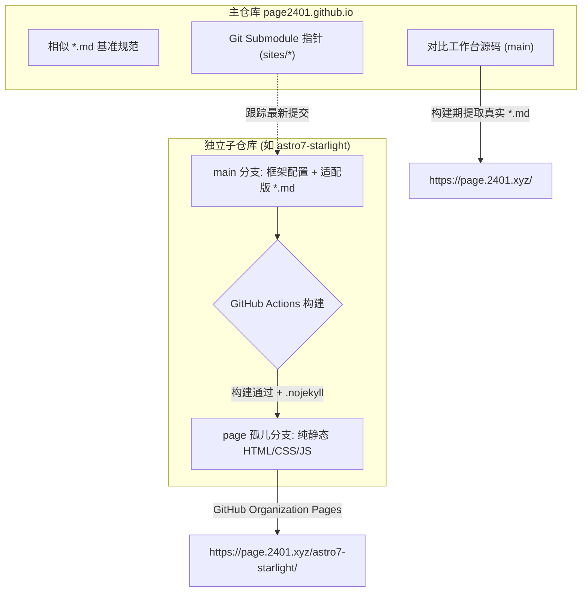
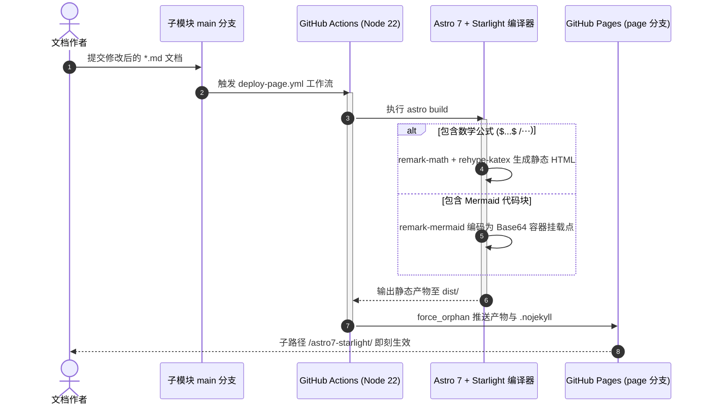
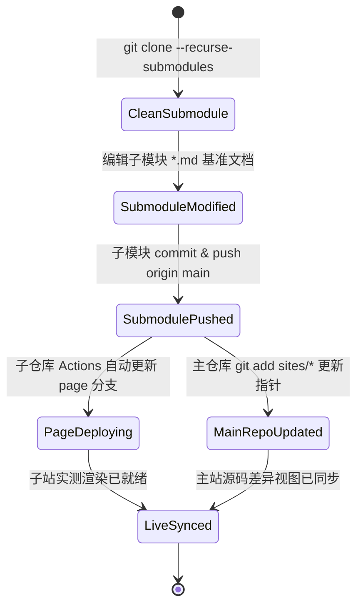

Astro Starlight 默认使用 `astro-expressive-code` 将 ` ```mermaid ` 代码块作为静态代码高亮展示。本子站通过自定义前置 `remark-mermaid.mjs` 插件将 Mermaid 节点转换为容器，并在覆写的 `Head.astro` 中打包最新 **`mermaid@12.3.0`**，联动 `data-theme` 实现深浅色无缝切换。

:::caution[插件管线与无头浏览器取舍]
社区部分构建期方案（如 `rehype-mermaid`）依赖在 CI 安装 Playwright / Chromium 无头浏览器，体积庞大且在边缘构建环境易受限；采用前置 Remark AST 转换 + Vite 打包客户端 `mermaid@12.3.0` 可在零外部依赖下支持最新的第 12 代图表语法与动态主题切换。
:::

## 1. 复杂子图与架构流程图（`flowchart TD`）

测试中文节点标签、子图嵌套（`subgraph`）、虚线边与条件分支：



## 2. 编译管线交互时序图（`sequenceDiagram`）

测试多参与者生命线、`alt` 分支块及激活框（`activate`/`deactivate`）：



## 3. 子模块同步状态机（`stateDiagram-v2`）

测试状态机语法与状态迁移说明标签：


