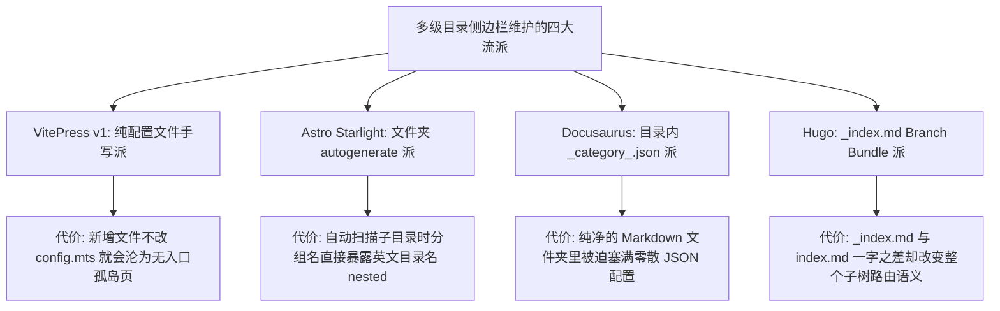

静态网站生成器的目录组织看似简单，实则受制于一组**不可能三角**：**本地编辑器/GitHub 浏览友好度**、**生成 URL 的纯净度**、以及**多级侧边栏的零配置自动化**，没有任何一个现有方案能同时完美兼顾三者。

## 1. 痛点一：文档根目录隔离 vs 目录层级深度

在 **Astro 7 + Starlight (`0.43.1`)** 中，框架通过 Content Layer 强制将所有文档收束在 `src/content/docs/` 下：

- **优势**：工程边界绝对干净——根目录下的 `README.md`、`package.json` 绝不会被误编译成公开网页，组件（`src/components/`）与样式（`src/styles/`）各司其职。
- **真实痛点**：**前置目录深达 3 层（`src/content/docs/`）**。如果您原本有一个现成的纯 Markdown 知识库（如 Obsidian Vault 或团队 Git 文档库）想直接作为子模块挂载渲染，这种深嵌套约定就显得极具侵入性。

:::caution[对比 VitePress v1 的另一极端]
VitePress v1 允许直接在项目根目录平铺 `.md` 文件，目录层级为零；但代价是内容与配置混放，必须手动编写 `srcExclude: ['README.md']` 才能避免把仓库说明文档误发布到线上。
:::

## 2. 痛点二：本地排序前缀（`01-`）与干净 URL 的两难

当一个目录下有多篇有先后阅读顺序的文档时：

| 排序策略 | 在 IDE / GitHub 文件列表中的顺序 | 生成的线上 URL | 核心代价 |
| :--- | :--- | :--- | :--- |
| **纯语义文件名 + Frontmatter `order`** （本子站做法：`zeta-first.md` 设 `order: 1`） | 按字母序 `alpha-second.md` 排在 `zeta-first.md` 前面（**本地文件列表顺序与阅读顺序相反**！） | `/04-directory/nested/zeta-first`（**URL 干净永久稳定**，随时改 `order` 不破坏外部链接） | 当一个目录有 30 篇文档时，在 VS Code 文件树里根本看不出阅读先后顺序 |
| **文件名加数字前缀** （VitePress 子站做法：`01-prefix-order.md`） | 按 `01`、`02` 整齐排列，一目了然 | `/04-directory/nested/01-prefix-order`（URL 被数字前缀污染，插队重排即导致旧链接 404） | 需要额外维护复杂的 `rewrites` 路由映射表 |

## 3. 痛点三：多级嵌套子目录与侧边栏四大流派对比

本章节在 `astro.config.mjs` 中启用了 Starlight 原生的 `{ autogenerate: { directory: '04-directory' } }`，专门建立了嵌套子目录 `04-directory/nested/` 实测优缺点（请观察本页左侧边栏菜单）：

- [进入嵌套子页 1（`order: 1`）：`nested/zeta-first`](/astro7-starlight/04-directory/nested/zeta-first)
- [进入嵌套子页 2（`order: 2`）：`nested/alpha-second`](/astro7-starlight/04-directory/nested/alpha-second)

